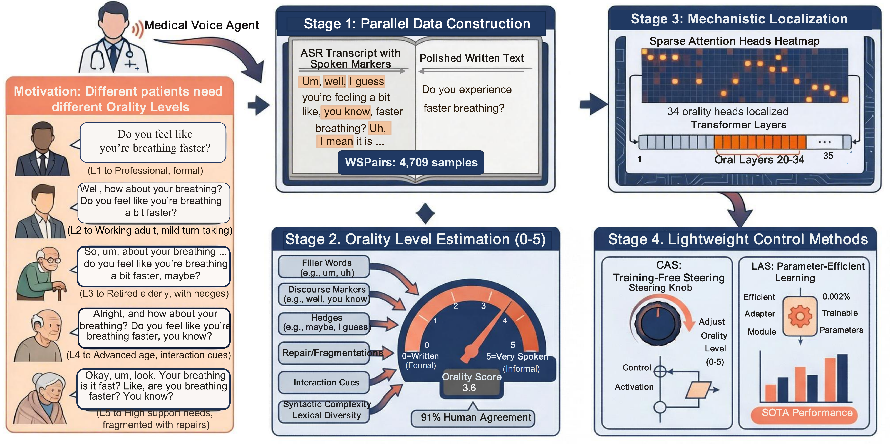
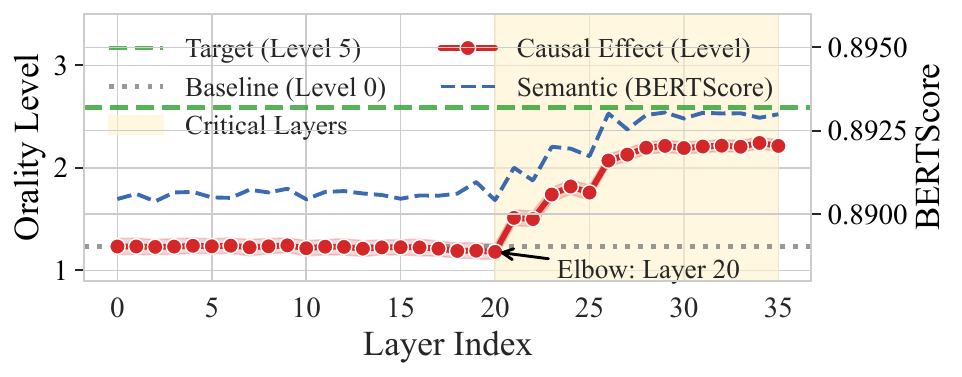
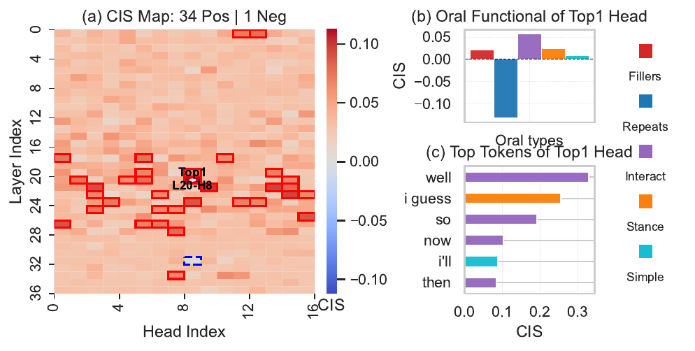
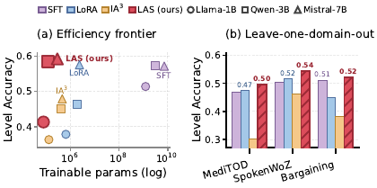
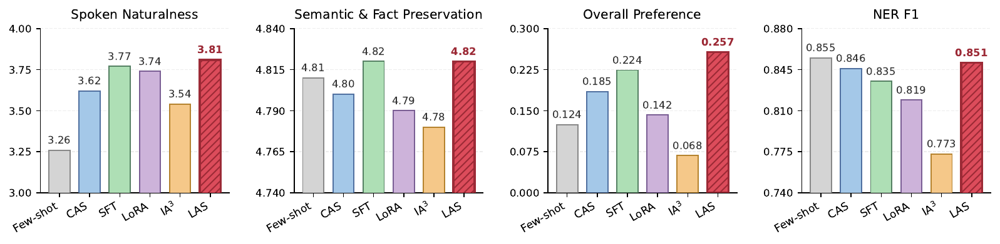
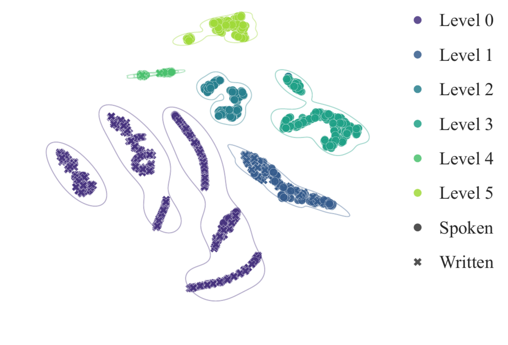

<div align="center">

# Unlocking the Spoken Style
### Mechanistic Localization and Lightweight Control of Orality in LLMs

[](https://arxiv.org/abs/xxxx.xxxxx)
[](LICENSE)
[](https://www.python.org/)
[](https://pytorch.org/)
[](https://huggingface.co/)
[](https://github.com/iin729/llm-spoken/stargazers)
[](https://twitter.com/intent/tweet?text=Spoken%20style%20in%20LLMs%20lives%20in%20a%20sparse%20band%20of%2035%20late-layer%20attention%20heads.%0ASteering%20just%200.004%25%20of%20the%20parameters%20matches%20full%20SFT.&url=https%3A%2F%2Fgithub.com%2Fiin729%2Fllm-spoken)

</div>

<p align="center">
  
</p>

<h3 align="center">
  Spoken style in LLMs is a <i>late-stage rendering circuit</i> —<br/>
  ~35 attention heads in late layers carry it, and steering just <b>0.004 %</b> of the parameters matches full SFT.
</h3>

<p align="center">
  <a href="#-tldr">TL;DR</a> ·
  <a href="#-the-problem"> The problem</a> ·
  <a href="#-how-orality-really-looks-levels-15">Case studies</a> ·
  <a href="#-mechanistic-finding-where-orality-lives-in-the-model">Mechanistic finding</a> ·
  <a href="#-headline-results">Results</a> ·
  <a href="#-quick-start">Quick start</a> ·
  <a href="#-cite-and-share">Cite</a>
</p>

---

## ✨ TL;DR

> **If you build voice agents** in healthcare, sales, or customer service, your LLM is the bottleneck — not the TTS. Even the warmest TTS sounds like it's *reading a script*, because LLMs are trained on written text.
>
> **We localize *style*** — not facts — inside an LLM for the first time. Orality lives in a sparse band of late-layer attention heads (35 heads on Qwen-2.5-3B). The same hockey-stick shows up on three backbones.
>
> **CAS and LAS** intervene only on that tiny circuit. CAS is **training-free** and beats ActAdd by up to **+24 L-Acc**; LAS uses **0.004 – 0.006 %** of the parameters and **matches full SFT**, beats LoRA by up to **+12.0 L-Acc**, and **leads three out-of-domain folds by up to +3.9 over SFT**.

⭐ **Star this repo if you want LLMs that speak like humans, not like spec sheets.** ⭐

---

## 🎙️ The problem

A triage assistant should NOT say:

> *"Are there any preexisting medical conditions, such as hypertension, diabetes, or other chronic illnesses?"*

A warm voice agent talking to an elderly patient should say:

> *"Alright, do you have any past medical conditions, like high blood pressure, diabetes, anything like that?"*

Both convey identical information. The second one is what makes patients comfortable enough to actually answer. TTS can't fix this mismatch — **the text itself is too written**. We need an LLM that can speak at a chosen *Orality Level* between 0 (formal) and 5 (strongly spontaneous).

---

## 💬 How orality really looks: Levels 1–5

We bundle a **4,709-pair corpus, WSPairs**, with ordinal Orality Levels (0–5). Below are real samples from `data/test.json`, same content, ascending orality. The same controller weights handle every level — you just set a target `t`.

<table>
<tr>
<th width="10%">Level</th>
<th width="42%">Written (Level 0)</th>
<th width="48%">Spoken (target level)</th>
</tr>

<tr>
<td align="center"><b>L1</b><br/><sub>medical</sub></td>
<td><i>Are there any preexisting medical conditions, such as hypertension, diabetes, or other chronic illnesses?</i></td>
<td>Alright, do you have any past medical conditions, <b>like</b> high blood pressure, diabetes, <b>anything like that</b>?</td>
</tr>

<tr>
<td align="center"><b>L2</b><br/><sub>medical</sub></td>
<td><i>Are there any indications of physical or emotional abuse in the home?</i></td>
<td><b>OK, um and um</b> any reasons or concerns for <b>um uh</b> physical or emotional abuse in the home?</td>
</tr>

<tr>
<td align="center"><b>L3</b><br/><sub>medical</sub></td>
<td><i>A few additional questions follow: are there any fainting spells, episodes of shortness of breath, or similar symptoms?</i></td>
<td><b>OK. Yeah, alright so uh</b> other than that, <b>sorry,</b> I think I might have forgotten to ask you a couple questions. <b>So</b> no fainting spells, no shortness of breath, <b>nothing like that</b>?</td>
</tr>

<tr>
<td align="center"><b>L4</b><br/><sub>negotiation</sub></td>
<td><i>They are not as nice and are more expensive; therefore, I believe you will find that 231 is a very good price.</i></td>
<td><b>Well,</b> They're not <b>and, they're they're</b> more expensive <b>Right</b> They're not as nice <b>and, they're they're</b> more expensive <b>So,</b> I think you'll find that 2-31 is a very good price.</td>
</tr>

<tr>
<td align="center"><b>L5</b><br/><sub>negotiation</sub></td>
<td><i>I believe that is a reasonable starting point. My original asking price was $240,000. Would you be able to consider $235,000?</i></td>
<td><b>Okay, I think I think</b> that's a pretty good starting point <b>Um</b> I my <b>um</b> original <b>Off</b> my original asking price was 2:40 <b>Um Is there any way you could do like</b> 2 35.</td>
</tr>
</table>

The **bolded spans** are exactly the seven sociolinguistic features our 7-feature Orality estimator picks up: fillers (*um, uh*), interaction markers (*you know, right*), stance / hedges (*I think, I guess*), lexical reduction (*gonna, wanna*), and repetition (*they're they're, I think I think*). Plus two written-oriented density measures (Propositional Idea Density, Noun-Verb Ratio).

The estimator agrees with **human pairwise judgments on 91 %** of held-out pairs — **higher than the LLM-judge ensemble (DeepSeek-R1 + Gemini-3-Flash + GPT-4o) and the best of four trained Bradley-Terry reward models.** See [`orality/`](orality/) and Appendix B.

---

## 🧠 Mechanistic finding: where orality lives in the model

This is — to our knowledge — the first time *style* (rather than facts, refusal, or emotion) has been mechanistically localized inside an LLM.

### 1️⃣ Layer-level patching reveals a hockey-stick

We swap hidden states from a Level-5 (spoken) run into a Level-0 (written) run, one layer at a time, and measure how spoken the output becomes (red curve). BERTScore stays > 0.86 throughout (blue) — we move *style*, not *content*:

<p align="center">
  
</p>

<p align="center"><b>
Orality is concentrated in the last ~45 % of the network. The elbow defines L_oral = {20, ..., 35} on Qwen-2.5-3B.<br/>
Replicates: Llama-3.2-1B elbow at layer 5; Mistral-7B-Instruct-v0.3 at layer 15.
</b></p>

### 2️⃣ A sparse handful of attention heads carry it

Inside `L_oral`, we apply Contrastive Influence Score (CIS, Eq. 1 in the paper): zero-ablate each head and measure the per-token probability gap on oral-marker vocab vs. non-oral content vocab. Out of **448 heads on Qwen-2.5-3B, only 35** exceed the 2σ threshold — almost all in layers 20–30.

<p align="center">
  
</p>

The top-CIS head is **L20–H8**. When we look at the tokens it promotes in the oral logit direction, it's almost a textbook discourse-rendering head: **well, so, now, I guess, you know,** plus turn-organizing conjunctions. It's not "a generic style head" — it specifically renders interaction markers and hedges.

> **Style is sparse, late, and replicable.** Same pattern on Llama-3.2-1B (32 heads, layers 5–15) and Mistral-7B-Instruct-v0.3 (49 heads, layers 15–31).

---

## 🎛️ Two controllers on the localized circuit

<table>
<tr>
<th width="50%">CAS — training-free knob</th>
<th width="50%">LAS — learned, parameter-efficient</th>
</tr>
<tr>
<td valign="top">

For each oral layer ℓ, add a calibrated direction:

```
h'_ℓ = h_ℓ + α*(t) · v̂_ℓ
```

- `v̂_ℓ` = mean L5 – L0 hidden-state diff at the chat-template token (L2-normalised).
- `α*(t)` = a **quadratic** calibrated on a 1K-sample held-out set, anchored at `(t=0, α=0)`.
- Extends ActAdd (one layer, one scalar) along **two** axes.
- **No gradient updates.** Inference cost overhead < 1.5 %.

Ablating either axis costs **12 – 25 L-Acc** points — the quadratic fit alone is worth 9.7 over isotonic regression (it can extrapolate past the sweep grid).

→ See [`cas/`](cas/)

</td>
<td valign="top">

On the same components, learn a per-component element-wise affine with **d, b ∈ ℝ^d** initialised to zero (start from identity):

```
h^{c'} = h^c + d_c ⊙ h^c + b_c
```

- Train only `{d_c, b_c}` with cross-entropy on parallel data.
- Touches **only** the oral layers' residual stream **and** the `d_head` block of each oral head's `o_proj` input.
- **Backbone is frozen.**
- Total trainable: **78K / 119K / 295K** on Llama-1B / Qwen-3B / Mistral-7B = **0.004 – 0.006 % of the backbone.**

→ See [`las/`](las/)

</td>
</tr>
</table>

---

## 📊 Headline results

### Training-free control (Table 1, $L\!-\!Acc \uparrow$)

| Backbone | Few-shot | ActAdd | **CAS (ours)** |
|----------|:---:|:---:|:---:|
| Qwen-2.5-3B | 0.246 | 0.149 | **0.390** &nbsp;<sub>(+24.1 over ActAdd)</sub> |
| Mistral-7B  | 0.210 | 0.324 | **0.378** &nbsp;<sub>(+5.4)</sub> |
| Qwen-2.5-7B | 0.169 | 0.053 | **0.245** &nbsp;<sub>(+19.2)</sub> |

> CAS dominates the training-free race on every backbone. Tokens/s overhead **< 1.5 %**. The orthogonal reward-model evaluator ΔR<sub>r</sub> ranks identically — outputs track ground-truth spoken intensity under a metric that never sees our estimator `g(·)`.

### Supervised control (Table 2)

| Backbone | Method | Params | L-Acc ↑ | ΔR<sub>r</sub> ↓ |
|----------|--------|:---:|:---:|:---:|
| Qwen-2.5-3B | _SFT (ref ceiling)_ | _3.0 B (100 %)_ | _0.573_ | _0.24_ |
| Qwen-2.5-3B | LoRA r=4 | 1.9 M (0.061 %) | 0.464 | 0.42 |
| Qwen-2.5-3B | IA³ | 0.4 M (0.013 %) | 0.451 | 0.46 |
| Qwen-2.5-3B | **LAS (ours)** | **119 K (0.004 %)** | **0.584 🥇** | **0.21 🥇** |
| Mistral-7B  | _SFT (ref ceiling)_ | _7.2 B (100 %)_ | _0.572_ | _0.23_ |
| Mistral-7B  | LoRA r=4 | 2.4 M (0.033 %) | 0.575 | 0.28 |
| Mistral-7B  | IA³ | 0.5 M (0.006 %) | 0.479 | 0.45 |
| Mistral-7B  | **LAS (ours)** | **295 K (0.004 %)** | **0.592 🥇** | **0.19 🥇** |

> LAS at **0.004 %** beats LoRA by **+12.0 L-Acc** on Qwen-3B and **beats full SFT on Mistral-7B** in-domain. Under the orthogonal reward evaluator, the gap to LoRA/IA³ (≥ 0.15) far exceeds the gap to SFT (≤ 0.04).

### Out-of-domain transfer (Fig. eff_ood)

<p align="center">
  
</p>

<p align="center"><b>
LAS leads all three leave-one-domain-out folds, beating SFT by 0.9 – 3.9 L-Acc points.<br/>
The oral L+H set identified once on training transfers verbatim out-of-domain.
</b></p>

### Blind human evaluation (n = 900, 3 NLP experts)

<p align="center">
  
</p>

LAS is the **only method in the top region of every quality axis simultaneously**:
- Spoken Naturalness **3.81 / 5**
- Overall Preference **25.7 %** (highest)
- Semantic Preservation **4.82 / 5** (ties SFT)
- NER F1 **0.851** (vs. SFT 0.835, LoRA 0.819, Few-shot ceiling 0.855)

Inter-annotator agreement Fleiss' κ = 0.64 / 0.72 (Likert), Kendall's W = 0.78 (ranking).

---

## 🚀 Quick start

```bash
git clone xxx
cd llm-spoken
pip install -r requirements.txt
python -m spacy download en_core_web_sm
```

### Three commands → reproduce the headline number

```bash
# (a) [optional] Recompute the oral heads set — bundled in mech_analysis/heads_idx/
bash mech_analysis/head_attribution/scripts/run_identify_qwen3b.sh

# (b) Train LAS on Qwen-2.5-3B  (119 K params, ~1.5 h on one A800)
bash las/scripts/run_train_las.sh BACKBONE=qwen3b

# (c) Evaluate on the WSPairs test split
python las/eval_las.py \
    --model_name_or_path Qwen/Qwen2.5-3B-Instruct \
    --las_ckpt           las/runs/Qwen2.5-3B-Instruct_las \
    --eval_file          data/test.json \
    --output_dir         las/runs/Qwen2.5-3B-Instruct_las/eval
python -m orality.eval_predictions \
    --pred_file las/runs/Qwen2.5-3B-Instruct_las/eval/predictions.jsonl
```

Expected: **L-Acc ≈ 0.58, ΔR<sub>r</sub> ≈ 0.21** — row "LAS / Qwen-3B" of Table 2.

### Training-free CAS in two commands

```bash
bash cas/scripts/run_extract_style_vectors.sh   # ~10 min/backbone on one A800
bash cas/scripts/run_cas_pipeline.sh            # sweep α → fit α=f(t) → predict → eval
```

### Score *any* generations with our orality estimator

```python
from orality import stat_all_metrics, eval_oscore_and_level

stats          = stat_all_metrics("OK so, um, what's going on?")
o_score, level = eval_oscore_and_level(stats)
print(level)   # → 4
```

---

## 🗺️ Repository structure

```
llm-spoken/
├── data/                      📚 WSPairs splits (train/dev/test/calibration)  ⤵
├── orality/                   📏 Orality Level estimator g(·)  +  metrics
├── mech_analysis/             🧠 Layer patching + head attribution (Sec. 3)
│   ├── head_attribution/      ↳  zero-ablation generator + CIS
│   └── heads_idx/             ↳  pre-computed A_oral for 3 backbones
├── cas/                       🎛️ CAS — training-free controller (Sec. 4.1)
│   ├── extract_style_vectors.py
│   ├── cas_injector.py        ↳  calibrate / analyze / predict modes
│   └── ablation/              ↳  Table 3 ablations (−Calib / −Multi / Iso / Rnd L / Rnd v)
├── las/                       🎛️ LAS — learned, parameter-efficient (Sec. 4.2)
│   ├── train_las.py / eval_las.py
│   └── ablation/              ↳  Table 4 ablations (LoRA / IA³ / ReFT r=4 / −Sc / −Bi)
├── baselines/                 🏛️ SFT_ref / LoRA / IA³
├── evaluator_validation/      🔎 g(·) vs LLM judges + reward-model training (Appendix B)
└── assets/                    🖼️ Figures used in this README and the paper
```

Each subdirectory ships its own README that maps directly back to the corresponding paper section.

---

## 🧪 What's inside the data

WSPairs covers three real-world conversational domains:

| Domain | Source | What it looks like |
| --- | --- | --- |
| 🏥 Medical | [MediTOD](https://arxiv.org/abs/2411.00489) | doctor–patient triage dialogues |
| 📞 Task-oriented | [SpokenWoZ](https://arxiv.org/abs/2305.13040) | restaurant, taxi, hotel bookings |
| 🤝 Negotiation | [Bargaining](https://aclanthology.org/2023.acl-long.395/) | house-sale negotiations |

**4,709 written–spoken pairs.** Every pair carries a 7-feature orality vector and an ordinal level (0–5). The full level manifold separates cleanly in t-SNE:

<p align="center">
  
</p>

> The 6 ordinal levels form a single, monotone manifold — confirming the EWM + KMeans estimator induces an *ordered* category set rather than scattered classes.

---

## 🔬 Reproducibility checklist

- ✅ **Code:** all training / inference / evaluation entry points, end-to-end.
- ✅ **Data:** WSPairs main splits + a 1 K-sample CAS calibration set.
- ✅ **Bundled artefacts:** the pre-fit orality model (`orality/oral_level_model.pkl`) and the per-backbone oral-head sets (`mech_analysis/heads_idx/*.json`).
- ✅ **Hardware:** any single 24 GB GPU runs 1B / 3B; 4 × A100 40 GB trains Mistral-7B comfortably.
- ✅ **Determinism:** all training scripts set `seed=42` and `set_seed()` from `transformers`; numbers reproduce ± 0.5 L-Acc.
- ✅ **Deps:** strict version pins in [`requirements.txt`](requirements.txt).
- ✅ **Independent evaluator:** ΔR<sub>r</sub> column is computed with a separately-trained Bradley-Terry reward model in [`evaluator_validation/`](evaluator_validation/).

---

## 🌍 Where this matters

If you build any of these systems, LAS should drop into your inference pipeline with no architecture changes:

- **Healthcare voice agents** (the example in our intro — triage, follow-up, mental health intake).
- **Sales / customer success bots** where rapport-building matters more than literal correctness.
- **Negotiation and persuasion agents** (think: AI sales coach, real-estate matchmaker).
- **Personality-controllable assistants** — *localize-then-steer* generalizes beyond orality.

---

## 🛣️ Roadmap

- [ ] Hosted LAS adapter checkpoints on Hugging Face (3 backbones × main + 3 OOD folds).
- [ ] One-click Colab demo: type a written sentence + pick a level → get the rewrite.
- [ ] Apply *localize-then-steer* to other surface-style attributes (politeness, formality, persona).
- [ ] Multilingual orality (Mandarin first — interaction markers and hedges look very different).

PRs and issues are welcome — see [CONTRIBUTING] (coming soon) for the dev workflow.

---


## 🙏 Acknowledgements

This work builds on the open scientific stack: 🤗 Transformers, PEFT, BERTScore, ideadensity, spaCy, scikit-learn — and the public corpora released by the SpokenWoZ, MediTOD, and Bargaining teams. Thank you.

---

## 📜 License

MIT — see [LICENSE](LICENSE). The WSPairs annotation layer (orality levels + 7-feature scores) is also MIT; the underlying transcripts retain their source corpora's licenses.


